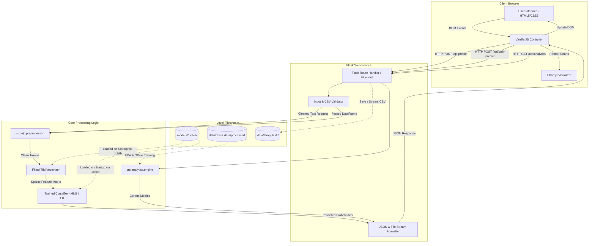
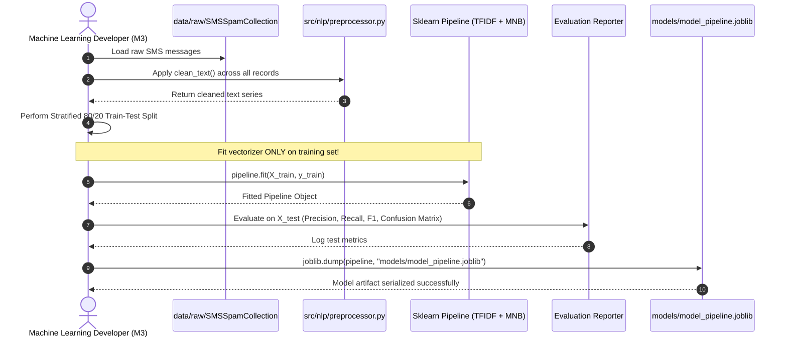
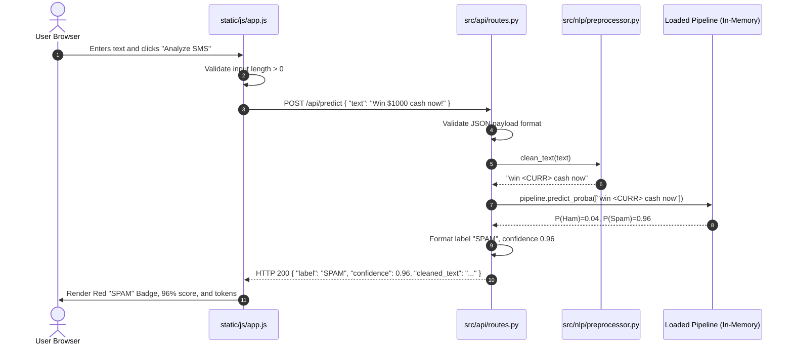
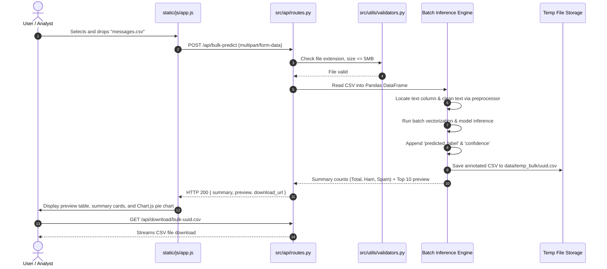

# 04. System Architecture & Workflows

> **Document Status:** `PROPOSED` Baseline  
> **Project ID:** NLP-04  
> **Product Working Title:** SMS Shield  
> **Architect:** M1 (Project Lead)  
> **Reviewed By:** M2, M3, M4, M5

---

## 1. High-Level System Architecture

SMS Shield is structured as a decoupled, modular three-tier architecture:
1. **Presentation Tier (Client):** Responsive Single-Page Application (SPA) dashboard built with Semantic HTML5, CSS3, Vanilla ES6 JavaScript, and Chart.js.
2. **Application Tier (Backend Service):** Flask application providing RESTful API endpoints, request routing, payload validation, and data orchestration.
3. **Machine Learning & NLP Tier (Core Engine):** Decoupled Python modules responsible for text preprocessing, TF-IDF feature extraction, model inference, and statistical analytics.

---

## 2. Component Responsibilities

| Component | Module Path | Primary Responsibility | Owned By |
| :--- | :--- | :--- | :--- |
| **Web Server & Routing** | `app.py`, `src/api/routes.py` | Initializes Flask app, serves HTML templates, maps endpoints, handles global HTTP errors. | **M4 (Backend)** |
| **Request & File Validation** | `src/utils/validators.py` | Sanitizes string inputs, checks MIME types and file size boundaries, prevents path traversal. | **M4 (Backend)** |
| **Text Preprocessing** | `src/nlp/preprocessor.py` | Executes regex scrubbing, URL masking, lowercasing, negation preservation, and stopword filtering. | **M2 (NLP)** |
| **Feature Extraction & ML** | `src/models/classifier.py` | Houses pipeline loading, vector transformation, class probability generation, and metrics evaluation. | **M3 (ML)** |
| **Model Persistence** | `src/models/train.py` | Offline script to execute stratified train-test split, fit vectorizer, train models, and serialize to `models/*.joblib`. | **M3 (ML)** |
| **Analytics Engine** | `src/analytics/engine.py` | Computes corpus-level metrics (class distribution, word lengths, n-gram frequencies) for dashboard display. | **M1 (Lead)** |
| **Client UI & Visuals** | `templates/index.html`, `static/js/app.js` | Captures user inputs, makes async fetch requests, handles loading spinners, and dynamically draws Chart.js graphs. | **M5 (Frontend)** |

---

## 3. End-to-End Workflows

### 3.1 Offline Training Workflow (Executed Prior to Web Deployment)

---

### 3.2 Single SMS Prediction Workflow (Runtime)

---

### 3.3 Bulk CSV Processing Workflow (Runtime)

---

## 4. Key Architectural Decisions

1. **Integrated Scikit-learn Pipeline vs. Separate Vectorizer/Model:**
   - *Decision:* Bundle the `TfidfVectorizer` and `MultinomialNB` into an `sklearn.pipeline.Pipeline` or a structured dictionary bundle when saving to Joblib.
   - *Rationale:* Eliminates desynchronization between feature extraction and classification during inference.
2. **In-Memory Model Loading:**
   - *Decision:* Load the model artifact once at Flask application startup (`app.py`), storing it in application memory context.
   - *Rationale:* Loading a Joblib file from disk takes ~100ms. Doing this on every HTTP request would create severe latency; in-memory inference takes under 1ms per SMS.
3. **Stateless API Design:**
   - *Decision:* All endpoints are stateless; no session cookies or user authentication required for MVP.
   - *Rationale:* Minimizes technical debt, prevents security vulnerabilities related to session hijacking, and fits the academic schedule.
