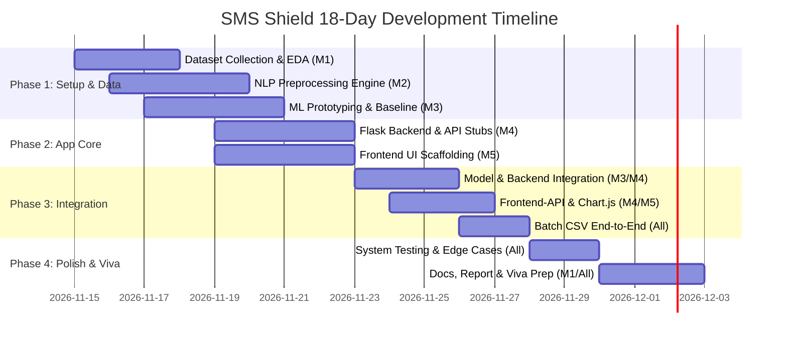

# 09. 18-Day Phased Development Roadmap

> **Document Status:** `PROPOSED` Baseline  
> **Project ID:** NLP-04  
> **Product Working Title:** SMS Shield  
> **Project Timeline:** 18 Working Days (~2.5 - 3 Weeks)  
> **Author:** M1 (Project Lead)  
> **Reviewers:** M2, M3, M4, M5

---

## 1. Roadmap Overview & Phasing Strategy

The 18-day roadmap is structured into 4 distinct phases designed to allow maximal parallel work between team pairs while enforcing strict quality checkpoints before integration.

---

## 2. Daily Schedule, Deliverables & Handoffs

### Phase 1: Foundations, Exploration & NLP Preprocessing (Days 1–5)

#### Day 1: Project Kickoff & Dataset Acquisition
- **M1 (Lead):** Initialize git repository, download raw UCI SMS Spam Collection, verify record count and column format. Create `notebooks/01_eda_and_prototyping.ipynb`.
- **M2 (NLP):** Research SMS text cleaning patterns (URL regex, currency symbols, stopword lists).
- **M3 (ML):** Review Scikit-learn TF-IDF vectorization and Multinomial Naive Bayes parameters.
- **M4 (Backend):** Set up Python virtual environment, create `requirements.txt`, scaffold `app.py`.
- **M5 (Frontend):** Draft UI wireframes, research Chart.js layout for single/bulk view.
- **Milestone 1:** Raw dataset verified in `data/raw/` and repository dependencies installed by all members.

#### Day 2: Exploratory Data Analysis & Preprocessing Design
- **M1:** Complete dataset EDA in notebook (class counts, average message lengths, word clouds).
- **M2:** Implement baseline text cleaning in `src/nlp/preprocessor.py` (lowercasing, URL masking, punctuation stripping).
- **M3:** Write offline train-test split function with stratification (80% train, 20% test).
- **M4:** Create basic Flask app serving `GET /api/health`.
- **M5:** Build initial `templates/index.html` structure with semantic header, main tabs, and footer.

#### Day 3: Stopword Filtering & Negation Handling
- **M1:** Document verified dataset statistics in `docs/07-data-models.md`.
- **M2:** Refine `preprocessor.py` to preserve negations (`not`, `no`, `never`). Write unit tests in `tests/test_nlp.py`.
- **M3:** Test TF-IDF vectorizer configurations (`ngram_range=(1,2)`, `max_features=3000`).
- **M4:** Scaffold Flask route structure in `src/api/routes.py` with mock responses.
- **M5:** Style single SMS input layout and submit buttons in `static/css/style.css`.
- **Handoff:** M2 hands tested `clean_text()` function to M3.

#### Day 4: Baseline ML Model Training
- **M1:** Create `src/analytics/engine.py` to extract distribution arrays for the dashboard.
- **M2:** Expand `test_nlp.py` covering edge cases (empty text, pure numbers, emojis).
- **M3:** Implement `src/models/train.py` using `MultinomialNB`. Fit pipeline on `X_train` and evaluate on `X_test`.
- **M4:** Implement input validation helper in `src/utils/validators.py`.
- **M5:** Add responsive CSS media queries for mobile and tablet screens.

#### Day 5: Model Serialization & Comparison
- **M1:** Review model training code and compare baseline metrics.
- **M2:** Add docstrings and type annotations to `src/nlp/`.
- **M3:** Train `LogisticRegression` as a comparison model. Serialize champion pipeline to `models/model_pipeline.joblib`. Save metrics to `models/metrics_summary.json`.
- **M4:** Write unit test `tests/test_api.py` for `/api/health`.
- **M5:** Implement tab switching logic (Single SMS vs. Bulk CSV vs. Analytics) in `static/js/app.js`.
- **Milestone 2 (End of Phase 1):** Preprocessing tested, ML model trained and saved to disk.

---

### Phase 2: Application Development & API Integration (Days 6–10)

#### Day 6: Single SMS Prediction Pipeline
- **M3 & M4:** Connect Flask `/api/predict` endpoint to the loaded Joblib model artifact.
- **M2:** Verify preprocessing consistency between standalone script and web inference.
- **M5:** Wire single SMS form submit event to `POST /api/predict` via `fetch()`.
- **M1:** Begin drafting Section 1 and 2 of the Academic Project Report.

#### Day 7: Single Prediction UI & Badge Rendering
- **M4:** Add comprehensive error handling for `/api/predict` (HTTP 400 for empty or oversized text).
- **M5:** Render classification badge (Green for Ham, Red for Spam) and confidence progress bar.
- **M2:** Assist M4 with text length sanitization.
- **M3:** Add `tests/test_models.py` to test model deserialization and prediction deterministic outputs.
- **Milestone 3:** Working end-to-end Single SMS Classification feature.

#### Day 8: Bulk CSV Backend & File Validation
- **M4:** Implement `/api/bulk-predict` endpoint with file extension (`.csv`) and size ($\le 5\text{ MB}$) checks.
- **M3:** Optimize batch inference using vectorized DataFrame operations.
- **M2:** Add batch text cleaning utilities in `src/nlp/`.
- **M5:** Build CSV drag-and-drop zone and file input picker in UI.
- **M1:** Generate static analytics summary payloads for API integration.

#### Day 9: Bulk CSV UI & Table Preview
- **M4:** Implement temporary annotated CSV generation and `/api/download/<file_id>` route.
- **M5:** Parse bulk prediction JSON response, display summary cards (Total, Ham, Spam), and build top 10 preview table.
- **M1:** Connect `src/analytics/engine.py` to `GET /api/analytics`.
- **M3:** Validate that batch predictions match single prediction logic on identical text.

#### Day 10: Downloadable CSV & Cleanup
- **M4:** Implement streaming CSV download and temporary file cleanup logic.
- **M5:** Wire "Download Results CSV" button in UI.
- **M2 & M3:** Conduct code review on backend utility functions.
- **M1:** Review Day 10 progress and test bulk CSV upload with various test files.
- **Milestone 4 (End of Phase 2):** Working Bulk CSV upload, preview, and download.

---

### Phase 3: Analytics Dashboard & Integration (Days 11–14)

#### Day 11: Analytics Endpoint Integration
- **M1 & M4:** Finalize `GET /api/analytics` returning corpus metrics and model confusion matrix.
- **M5:** Integrate Chart.js via CDN or local bundle in `static/js/charts.js`.
- **M2 & M3:** Cross-check classification metrics across candidate models.

#### Day 12: Visual Chart Rendering
- **M5:** Render corpus distribution Pie chart and message length Bar chart using Chart.js.
- **M5:** Implement dynamic bulk prediction distribution chart upon CSV upload completion.
- **M4:** Write API integration tests in `tests/test_api.py` for `/api/analytics` and `/api/bulk-predict`.
- **M1:** Document model comparison table in `docs/15-viva-preparation.md`.

#### Day 13: End-to-End System Integration Testing
- **All Members:** Run comprehensive manual and automated test suites.
- **M2:** Test unusual SMS inputs (heavy emojis, slang, long URLs).
- **M3:** Test confidence score bounds and borderline classification cases.
- **M4:** Test corrupt, non-CSV, and 0-byte file uploads to ensure graceful HTTP 400 responses.
- **M5:** Test browser compatibility and mobile viewport responsiveness.

#### Day 14: Bug Fixing & Performance Tuning
- **M4 & M5:** Resolve any UI rendering glitches, spinner states, and error banner dismissals.
- **M3:** Verify that model inference does not reload files from disk on each request.
- **Milestone 5 (End of Phase 3):** Fully integrated, error-tolerant web application.

---

### Phase 4: Quality Assurance, Academic Report & Viva Defense (Days 15–18)

#### Day 15: Automated Test Suite & Code Cleanup
- **All Members:** Run `pytest tests/` and ensure all tests pass with zero errors.
- **M4:** Verify PEP 8 compliance and code formatting across `src/`.
- **M1:** Perform repository audit against `AGENTS.md` anti-hallucination and verification standards.

#### Day 16: Academic Project Report Drafting
- **M1 (Lead):** Compile formal project report (Abstract, Introduction, Literature Review, Methodology, Architecture).
- **M2:** Write Preprocessing & Tokenization sections of the report.
- **M3:** Write Feature Extraction (TF-IDF), Model Selection (Naive Bayes vs. Logistic Regression), and Evaluation sections.
- **M4:** Write Backend Architecture and API Design sections.
- **M5:** Write Frontend UI/UX and Visual Analytics sections.

#### Day 17: Presentation Slides (PPT) & Demo Script
- **All Members:** Assemble final PowerPoint presentation (15–20 slides).
- **M1 & M5:** Prepare live demonstration script (canonical Ham message, phishing Spam, bulk test CSV).
- **M4:** Prepare fallback offline video capture of the live demo.

#### Day 18: Mock Viva Defense & Final Submission
- **All Members:** Conduct internal mock viva using questions from `docs/15-viva-preparation.md`.
- **M1:** Final code freeze on GitHub `main` branch, tag release `v1.0.0`, and submit final deliverables.
- **Milestone 6:** Final Project Submission & Viva Readiness.
