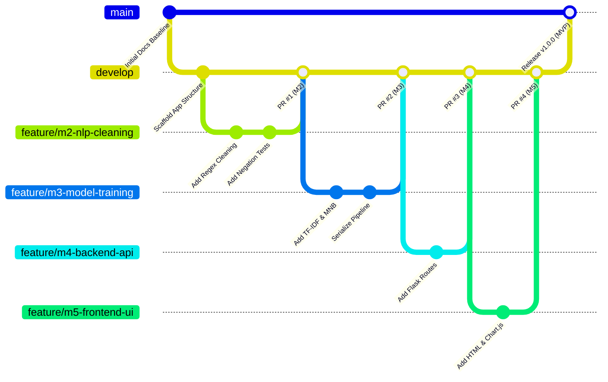

# 12. GitHub Collaboration, Branching & Review Workflow

> **Document Status:** `PROPOSED` Baseline  
> **Project ID:** NLP-04  
> **Product Working Title:** SMS Shield  
> **Author:** M1 (Project Lead)  
> **Reviewers:** M2, M3, M4, M5

---

## 1. Git Repository Architecture

The SMS Shield project follows a structured **Feature-Branch Git Workflow** to ensure team members can develop features in parallel without breaking the stable codebase. Direct commits to the `main` branch are strictly prohibited.



---

## 2. Branch Hierarchy & Naming Conventions

### 2.1 Branch Types
- **`main`:** The production-ready, evaluation-ready release branch. Must be 100% stable at all times. Tagged with semantic versions (e.g., `v1.0.0`).
- **`develop`:** The central integration branch where verified feature branches merge after code review.
- **`feature/<member>-<short-description>`:** Isolated work branches created from `develop`.

### 2.2 Branch Naming Standards
Every team member works on designated feature branches named according to their role ID:

| Member | Branch Naming Pattern | Example Branch Name |
| :--- | :--- | :--- |
| **M1 (Lead)** | `feature/m1-eda-analytics` | `feature/m1-eda-notebook` |
| **M2 (NLP)** | `feature/m2-nlp-<task>` | `feature/m2-nlp-cleaning-pipeline` |
| **M3 (ML)** | `feature/m3-ml-<task>` | `feature/m3-ml-training-pipeline` |
| **M4 (Backend)** | `feature/m4-api-<task>` | `feature/m4-api-bulk-predict` |
| **M5 (Frontend)** | `feature/m5-ui-<task>` | `feature/m5-ui-chartjs-dashboard` |
| **Bugfix (Any)** | `bugfix/<issue-id>-<desc>` | `bugfix/issue-14-csv-delimiter` |

---

## 3. Commit Message Conventions

All team members and AI coding assistants must use the **Conventional Commits** specification:

```text
<type>(<scope>): <short descriptive summary in imperative mood>

[optional body explaining motivation and changes]
```

### 3.1 Allowed Commit Types
- `feat`: A new user-facing feature or API endpoint.
- `fix`: A bug fix or patch.
- `docs`: Documentation changes, markdown updates, comments.
- `test`: Adding or updating automated tests (Pytest).
- `refactor`: Code changes that neither fix a bug nor add a feature.
- `chore`: Maintenance tasks, dependency updates, `.gitignore` adjustments.

### 3.2 Concrete Examples
- `feat(nlp): implement negation-preserving stopword filter`
- `feat(ml): train MultinomialNB with TF-IDF and save pipeline`
- `feat(api): add /api/predict single SMS endpoint`
- `fix(validators): prevent unhandled exception on empty CSV upload`
- `docs(api): update /api/bulk-predict response contract`
- `test(nlp): add unit tests for emoji and URL edge cases`

---

## 4. Pull Request (PR) & Code Review Protocol

### 4.1 Creating a Pull Request
1. Ensure your local branch is rebased or merged with the latest `develop`:
   ```bash
   git checkout feature/m2-nlp-cleaning
   git pull origin develop
   ```
2. Run the test suite locally and verify 100% pass rate:
   ```bash
   pytest tests/
   ```
3. Push your feature branch to GitHub:
   ```bash
   git push origin feature/m2-nlp-cleaning
   ```
4. Open a Pull Request from `feature/m2-nlp-cleaning` into `develop`.

### 4.2 Pull Request Template
Every PR must include this checklist in its description:
```markdown
## Description of Changes
- Implemented regex cleaning rules in `src/nlp/preprocessor.py`.
- Preserved negation tokens ('not', 'no', 'never').

## Related Module & Role
- Role: M2 (NLP Preprocessing Developer)
- Target Directory: `src/nlp/`, `tests/`

## Testing Evidence
- Executed `pytest tests/test_nlp.py`.
- 12 passed in 0.45s.

## Documentation Updated
- Updated `docs/03-feature-specification.md`.

## Definition of Done Verification
- [x] Code adheres to PEP 8 standards.
- [x] All unit tests pass.
- [x] No unrelated files modified.
- [x] Documentation synchronized.
```

### 4.3 Code Review Rules
- Every PR requires at least **one peer review approval** before merging into `develop`.
- **Cross-Pair Review:**
  - Pair 1 (M2/M3) reviews Pair 2's PRs (M4/M5) to ensure API assumptions match ML expectations.
  - Pair 2 (M4/M5) reviews Pair 1's PRs (M2/M3) to ensure preprocessing outputs fit UI requirements.
- Project Lead (M1) performs final integration approval.

---

## 5. Conflict Resolution & Merge Strategy

- **Merge Method:** Use **Squash and Merge** or standard **Merge Commit** (configured by M1). Rebase is preferred for keeping feature branches up to date with `develop`.
- **Merge Conflicts:** If Git flags a conflict in shared files (e.g., `requirements.txt` or `app.py`):
  1. Never delete another member's lines blindly.
  2. The branch author must pull `develop`, resolve conflicts locally in VS Code, rerun `pytest tests/`, and push the resolved commit.

---

## 6. Definition of Done (DoD)

A task or feature branch is formally considered **DONE** and eligible for merging only when all of the following conditions are met:

1. **Code Complete:** Feature implementation satisfies all acceptance criteria in `docs/03-feature-specification.md`.
2. **Automated Tests Passing:** Unit and integration tests in `tests/` execute with zero failures.
3. **Zero Regressions:** Existing tests across all modules continue to pass.
4. **Code Quality:** Code is documented with Python type hints and docstrings; zero bare `except:` clauses.
5. **Documentation Synchronized:** Any change to schemas, APIs, or requirements is documented in the appropriate file in `docs/`.
6. **Peer Approval:** Approved by the assigned peer reviewer and signed off by Project Lead (M1).
